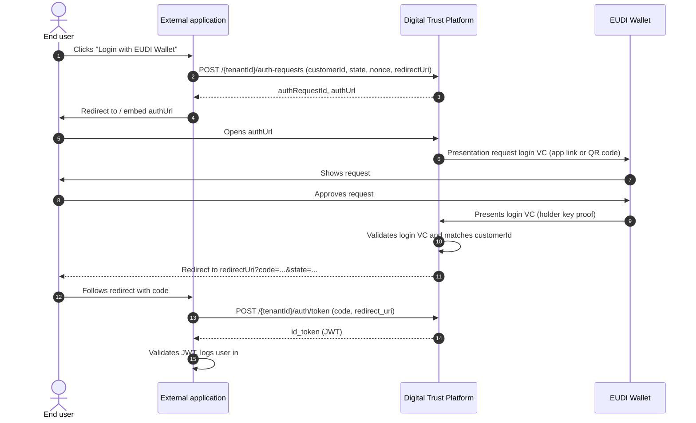

# EUDI Wallet authentication flow

The login requires that the customer has an active login VC. How the login VC is issued is described in [Login VC issuance flow](../../verifiable-credential-services/login-vc/login-vc-issuance-flow.md).

## Sequence



## Steps

1. **Create the authentication request.** For every login the external application calls the authenticate endpoint with the `customerId` of the user who wants to log in. See [Authenticate API](authenticate-api.md).
2. **Embed the returned link.** The DTP returns a unique, short-lived `authUrl`. The external application redirects the end user to this link (recommended) or embeds it in an iFrame, the same way as for the identification process.
3.  **Present the login VC.** On the DTP page the request is opened in the wallet:

    * **Same-device:** on a smartphone the wallet is opened directly via app link.
    * **Cross-device:** on a desktop a QR code is displayed which the end user scans with the wallet.

    The end user approves the request. Only the `customerId` of the login VC is shared.
4. **Validation by the DTP.** The DTP validates the login VC: signature and issuer (issued by the DTP for this tenant), validity, revocation status and holder binding. It checks that the `customerId` in the login VC matches the `customerId` of the request.
5. **Redirect back with a code.** The end user is redirected to the external application. On success an authorization `code` and the `state` are attached as query parameters (OIDC authorization code format). On failure `error`, `error_description` and `state` are attached.
6. **Exchange the code.** The external application exchanges the code server-to-server for an ID token (JWT) and logs the user in. See [Token exchange and ID token](token-exchange-and-id-token.md).

## Customer without login VC

If the customer has no active login VC (not enrolled yet, revoked or expired), the authentication fails with `NO_LOGIN_VC_AVAILABLE`. The external application then starts the enrolment, see [Login VC](../../verifiable-credential-services/login-vc/).


Tip: check the status of the customer's login VC with `GET /{tenantId}/verifiable-credentials?customerId=...` before showing the "Login with EUDI Wallet" button, and offer the enrolment instead if no login VC is `ISSUED`.


## Redirect configuration

There are two options to define where the end user is sent after the authentication. In both cases the OIDC parameters are appended to the URL.

<table data-full-width="true"><thead><tr><th width="260">Option</th><th>Description</th></tr></thead><tbody><tr><td><strong>Static redirect URLs</strong> (profile configuration)</td><td>A <code>successRedirectUrl</code> and a <code>failedRedirectUrl</code> are configured once in the tenant profile (on request). They are used for every authentication request that does not contain a <code>redirectUri</code>.</td></tr><tr><td><strong>Dynamic redirect URI</strong> (per request)</td><td>The external application submits a <code>redirectUri</code> in the authenticate request. It is used for both success and failure. For security reasons the <code>redirectUri</code> must match one of the allowed redirect URIs configured in the profile; otherwise the request is rejected with <code>400 INVALID_REDIRECT_URI</code>.</td></tr></tbody></table>

### Success redirect

```http
HTTP/1.1 302 Found
Location: https://app.example.com/login/callback?code=SplxlOBeZQQYbYS6WxSbIA&state=af0ifjsldkj
```

### Failed redirect

```http
HTTP/1.1 302 Found
Location: https://app.example.com/login/failed?error=access_denied&error_description=NO_LOGIN_VC_AVAILABLE&state=af0ifjsldkj
```


The external application must always compare the returned `state` with the value it sent in the authenticate request before exchanging the code, to protect against CSRF.

