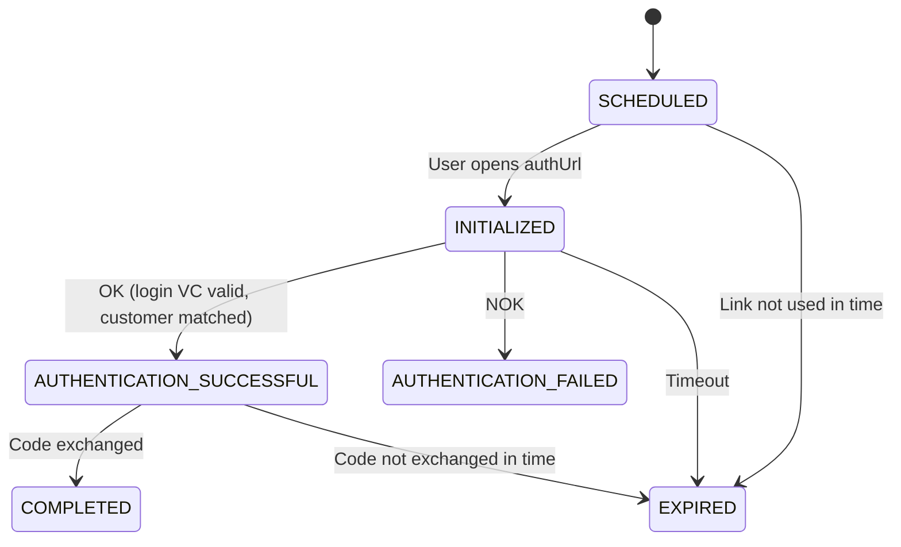

# EUDI Wallet authentication status and errors

Status of the authentication request (login). For the status of the login VC itself see [Login VC status and errors](../../verifiable-credential-services/login-vc/login-vc-status-and-errors.md).

## Status logic

<table data-full-width="true"><thead><tr><th width="300">Status</th><th>Description</th></tr></thead><tbody><tr><td>SCHEDULED</td><td>The authentication request was created and the <code>authUrl</code> returned.</td></tr><tr><td>INITIALIZED</td><td>The end user opened the <code>authUrl</code> and the presentation request was opened in the wallet.</td></tr><tr><td>AUTHENTICATION_SUCCESSFUL</td><td>The login VC (or PID as fallback) was presented, validated and matched to the <code>customerId</code>. The end user is redirected with a <code>code</code>.</td></tr><tr><td>AUTHENTICATION_FAILED</td><td>The authentication failed. The end user is redirected with <code>error</code> and <code>error_description</code>. A new authentication request must be created for a new attempt.</td></tr><tr><td>COMPLETED</td><td>The code was exchanged for an ID token. Final status.</td></tr><tr><td>EXPIRED</td><td>The link or the code was not used in time. Final status.</td></tr></tbody></table>

Optionally, the status updates can be sent to a webhook URL, the same way as for the identification notifications (setup on request).

## Customer matching

The DTP checks that the presented credential belongs to the `customerId` of the request:

* **Login VC:** the `customerId` in the login VC must be identical to the `customerId` of the request, the login VC must be issued by the DTP for this tenant, and the holder binding proves that it is presented from the enrolled wallet.
* **PID login (fallback):** if the customer was identified before via an identification case of the DTP, the PID attributes are compared with the stored identity. If no identity is bound to the `customerId` yet, the first successful PID login binds the presented PID to the `customerId`.

## Error codes

On failure the redirect contains `error` and `error_description`. The same values are returned as `statusReason` and `statusDetails` in the [Authenticate API](authenticate-api.md).

<table data-full-width="true"><thead><tr><th width="160">error (redirect)</th><th width="140">statusReason</th><th width="280">error_description / statusDetails</th><th>Description</th></tr></thead><tbody><tr><td><code>access_denied</code></td><td><code>ABORTED</code></td><td><code>NO_LOGIN_VC_AVAILABLE</code></td><td>No valid login VC of this tenant is in the user's wallet (not enrolled, revoked or expired). Start the <a href="../../verifiable-credential-services/login-vc/">enrolment</a>.</td></tr><tr><td><code>access_denied</code></td><td><code>ABORTED</code></td><td><code>NO_EUDI_PID_AVAILABLE</code></td><td>PID login only: no EUDI PID is available in the user's wallet.</td></tr><tr><td><code>access_denied</code></td><td><code>ABORTED</code></td><td><code>USER_DECLINED_REQUEST</code></td><td>User declined the request in the wallet.</td></tr><tr><td><code>access_denied</code></td><td><code>ABORTED</code></td><td><code>USER_CANCELLATION</code></td><td>User aborted on the DTP page.</td></tr><tr><td><code>access_denied</code></td><td><code>CANCELED</code></td><td><code>IDENTITY_MISMATCH</code></td><td>The <code>customerId</code> of the presented login VC, or the presented PID, does not match the <code>customerId</code> of the request.</td></tr><tr><td><code>access_denied</code></td><td><code>CANCELED</code></td><td><code>CREDENTIAL_EXPIRED</code></td><td>The presented login VC or PID is expired.</td></tr><tr><td><code>access_denied</code></td><td><code>CANCELED</code></td><td><code>CREDENTIAL_REVOKED</code></td><td>The presented login VC was revoked by the tenant, or the PID has been revoked or suspended.</td></tr><tr><td><code>access_denied</code></td><td><code>CANCELED</code></td><td><code>ISSUER_NOT_TRUSTED</code></td><td>The presented credential was not issued by the DTP for this tenant (login VC) or by a trusted PID provider (PID).</td></tr><tr><td><code>access_denied</code></td><td><code>CANCELED</code></td><td><code>PRESENTATION_INVALID</code></td><td>The presentation could not be validated (e.g. invalid holder binding).</td></tr><tr><td><code>temporarily_unavailable</code></td><td><code>ABORTED</code></td><td><code>STALLED_TIMEOUT</code></td><td>The wallet did not answer within the configured time.</td></tr><tr><td><code>server_error</code></td><td><code>ABORTED</code></td><td><code>WALLET_TECHNICAL_ERROR</code></td><td>Technical error in the wallet or the DTP.</td></tr></tbody></table>
