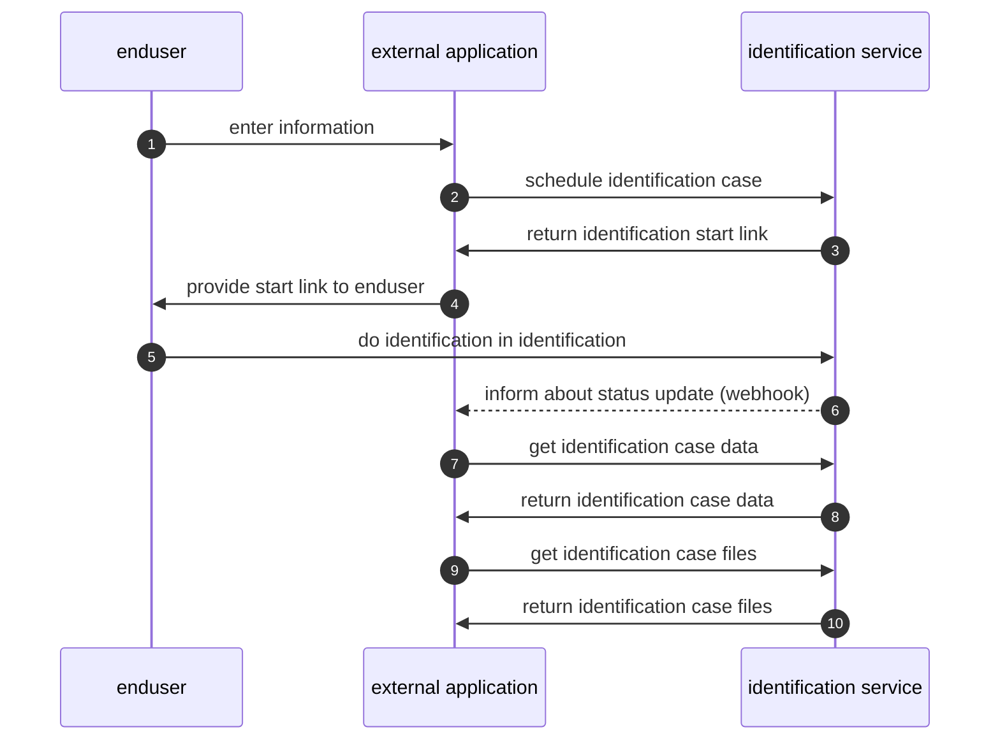

# Flow of integrating the identification process

The identification process can be scheduled directly within the existing user flow of the external application by calling a REST API. Once an identification process is scheduled, the REST API will return a identification URL. With this URL the end user will be able to identify themselves. The external application will be notified by webhook on the current status of the ongoing identification. Once the identification is completed the end user application can download all identification files and data per REST API.

## Steps of identification integration

* schedule an identification case from an external application (`POST` `/{tenantId}/id-cases/schedule`)
* a notification for each status update will be sent to notify the to external application (webhook)
* get identification case details `GET` `/{tenantId}/id-cases/{caseId}`
* get identification case files `GET` `/{tenantId}/id-cases/{caseId}/files.zip`

## Receive webhook Notifications

A notification is sent to the configured webhook URL when a case is created and whenever its status changes. [For more details, see the webhook notification documentation.](../general-information/webhook-notifications.md)
