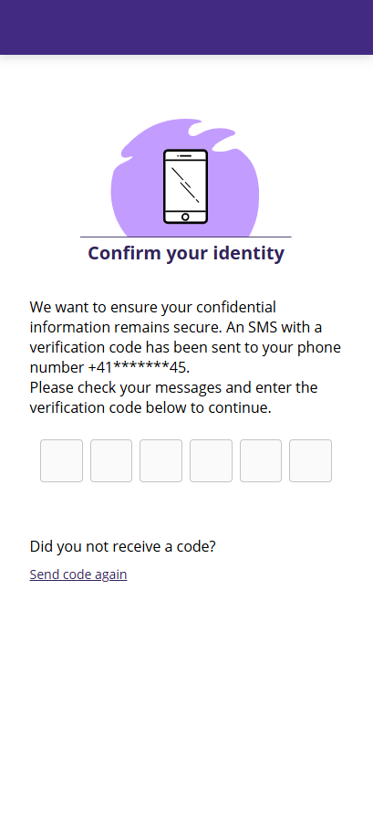

# 2FA protected links

| Last update of page | 20.01.2025 |
| ------------------- | ---------- |
| Available from      | 10.02.2025 |

The identification link and the smart-link can be secured with two-factor authentication (2FA). If this feature is enabled and the `protectedCase` parameter is set to `true` when creating a case or a signer, the end user will be required to enter a one-time password (OTP) sent to the provided phone number before starting the process.


This feature must be enabled by the provider. To request it, please place an order by creating a support ticket.




<figure><figcaption></figcaption></figure>


