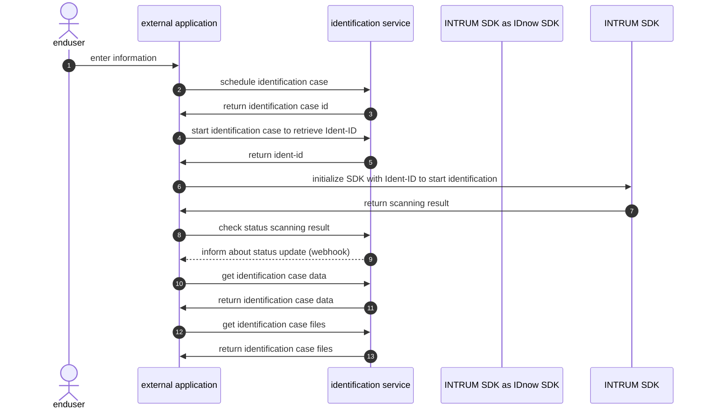

# AutoIdent (Intrum) with IDnow SDK

The identification process can be integrated easily into external applications that uses the IdNow SDK. The identification process can be scheduled directly within the existing user flow of the external application by calling 2 REST API(s). Once an identification process is scheduled, the end user will be able to identify themselves using the IDnow SDK. The external application will be notified by webhook on the current status of the ongoing identification. Once the identification is completed the end user application can download all identification files and data per REST API.

### Steps of identification integration using IDnow SDK process:

* schedule an identification case from an external application (`POST` `/{tenantId}/id-cases/schedule`)
* start the scheduled identification case to get the Ident-ID that must be mapped into the IDnow SDK. (`POST` `/{tenantId}/scheduled-cases/{caseId}/start`)
* Check status of scanning result from identification after result was retrieved from IDnow SDK (`GET` `{tenantId}/scheduled-cases/{caseId}/status`)
* get identification case details `GET` `/{tenantId}/id-cases/{caseId}`
* get identification case files `GET` `/{tenantId}/id-cases/{caseId}/files.zip`

### Error handling during identification process

If the end user aborts the process or if a technical error occurs, the case status will be updated to IDENTIFICATION\_FAILED. The sent webhook will include the ubiIdStatusReason = ABORTED and the detailed reason in the field ubiIdStatusDetails.

If a webhook with ubiIdStatusReason = ABORTED is received, the external application can either let the SDK handle the error or navigate the end user to error page of the external application.

The same ident-id can be used to initialize the SDK again, so that the end user can do the identification again. To do so the case should be restarted by calling the start API again (`POST` `/{tenantId}/scheduled-cases/{caseId}/start`) so that the case status is updated to "INITIALIZED".

During the identification process, the end user has to verify the phone number that was submitted when creating the identification case. In the case the submitted phone number is incorrect the sent webhook will include the ubiIdStatusReason = ABORTED and the ubiIdStatusDetails = USER\_CANCELLATION\_INCORRECT\_PHONE\_NUMBER. In this case, the end user should be navigated to a page of the external application, to update the phone number.

### Verification canceled process

After the identification an agent performs a manual review of the identification.

If the identification verification is canceled by the agent because the quality of the scanned result is not sufficient, the case will be updated to IDENTIFICATION\_FAILED. The sent webhook will include the ubiIdStatusReason = CANCELED and the detailed reason in the field ubiIdStatusDetails. Please check [the list of all returned details](/broken/pages/lVM5pRcepZIoO5ZfpegV). In this case it is recommended to show the end user a page, with a short explanation what went wrong and an option to start the identification again. The same ident-id can be used to initialize the SDK again, so that the end user can do the identification again. To do so the case should be restarted by calling the start API again (`POST` `/{tenantId}/scheduled-cases/{caseId}/start`) so that the case status is updated to "INITIALIZED".

### Integrating the IDnow SDK

For running the identification in a mobile app the IDnow SDK has to be integrated into the app. The SDK can be initialized with the Ident-ID which can be retrieved as described above. More details about the SDK can be found on the below links. To received updates on IDnow SDK releases please subscribe to both Github pages. All updates are published in the CHANGELOG.md file.

[AutoIdent SDK for iOS (Github)](https://github.com/idnow/de.idnow.ios.sdk.spm)

[AutoIdent SDK for Android (Github)](https://github.com/idnow/de.idnow.android.sdk)

It is recommended to update the IDnow SDK every 3 months. Each SDK version is supported for 6 month and has an end of life after 1 year. A detailed list of all released SDK versions including the End-of-Support date as well as the End-of-Life date can be found here: [IDnow Compatibility Matrix: Browser & OS Compatibility guide](https://www.idnow.io/developers/compatibility-overview/).
