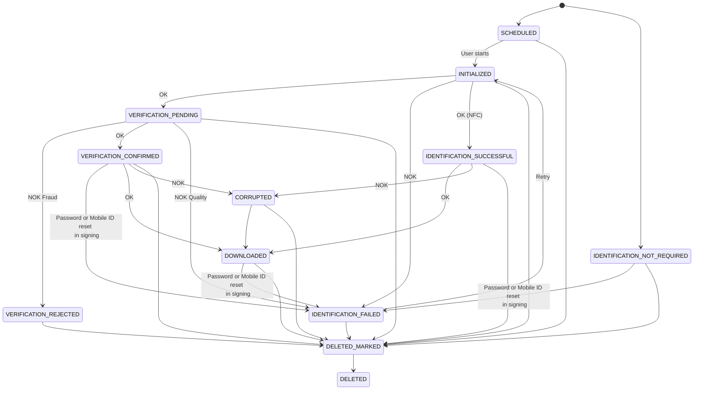

# AutoIdent (Intrum) status logic

On every status update a notification is sent to the external application. With the provided API's a case can be scheduled and the details of a identification case and the files can be downloaded.

<table data-full-width="true"><thead><tr><th width="317">Status</th><th>Description</th></tr></thead><tbody><tr><td>SCHEDULED</td><td><ul><li>The identification case is scheduled. the available personal data is posted to the identification application.</li><li>A startlink is created and a unique identification case id created.</li></ul></td></tr><tr><td>INITIALIZED</td><td><ul><li>The user has started the video sequence</li><li>If the user clicks on the "Retry" button, the INITIALIZED notification is sent again after the video sequence is restarted.</li><li>
Optionally, the external application can jump in, in the event of multiple retries. Depending on the integration type:
<ul><li>Jump to the identification process by using a QR code or open in a new browser: display a different page on the desktop application.</li><li>Overlay: closing the overlay</li></ul></li></ul></td></tr><tr><td>IDENTIFICATION_FAILED</td><td><ul><li>The user could not complete the video sequence.</li><li>The user is taken to an error page and can start the video sequence again.</li><li>This notification is sent for each failed identification. If the same case also fails after a retry, IDENTIFICATION_FAILED is sent again.</li><li>Optionally, the external application can jump in, in the event of multiple times receiving the status IDENTIFICATION_FAILED.</li></ul></td></tr><tr><td>VERIFICATION_PENDING</td><td><ul><li>A manual verification has be performed by an agent. Therefore, immediately after the identification has been set as successful, the status is set to VERIFICATION_PENDING.</li><li>The verification of the identification is pending after a successful identification.</li></ul></td></tr><tr><td>VERIFICATION_CONFIRMED</td><td><ul><li>An agent has confirmed the verification</li></ul></td></tr><tr><td>IDENTIFICATION_SUCCESSFUL</td><td><ul><li>NFC scan successfully completed in <a href="/broken/pages/FUB8StHho5UlJ4peJIvR">NFC-Based identification process</a></li></ul></td></tr><tr><td>VERIFICATION_REJECTED</td><td><ul><li>The agent has rejected the identification.</li></ul></td></tr><tr><td>IDENTIFICATION_FAILED</td><td>
The status could be updated to IDENTIFICATION_FAILED again after status:
<ul><li>After INITIALIZED if a problem occurred in the identification</li><li>After VERIFICATION_PENDING because the case could not be verified by the agent for quality reasons. The end user is allowed to do identification again.</li><li>After VERIFICATION_CONFIRMED and DOWNLOADED because the user wants to reset the password or reset the Mobile ID for Swisscom QES signing. The end user is allowed to do identification again.</li><li>After IDENTIFICATION_NOT_REQUIRED because the user wants to reset the password or reset the Mobile ID for Swisscom QES signing. The end user is allowed to do identification again.</li></ul></td></tr><tr><td>DOWNLOADED / CORRUPTED</td><td>
GetCase details and download identification zip file
<ul><li>By an API the case details can be get and a zip file with all identification files including an identification report downloaded</li><li>For the file download a notification is sent if the provided zip file could be generated successfully (status DOWNLOADED) or the zip file could not be generated completely (status CORRUPTED)</li><li>
Behavior when the download could be done successful
<ul><li>the status is DOWNLOADED</li><li>the zip file contains the video file and the identification report as well</li></ul></li><li>
Behavior when the provided zip file does not contain all information
<ul><li>the status is CORRUPTED</li><li>status is set when the video file is missing or the identification report could not be generated successfully</li><li>when the external application receives the status CORRUPTED the download must be triggered again (B). when now the zip could be generated completely the status will be set to DOWNLOADED</li></ul></li></ul></td></tr><tr><td>IDENTIFICATION_NOT_REQUIRED</td><td><ul><li>Depending on the configuration, a document-basket can be created with the parameter "doIdentification" = NEVER or "doIdentification" = IF_REQUIRED. This will allow to let a signer sign, without doing an identification first. For this an identification case is created with status IDENTIFICATION_NOT_REQUIRED.</li></ul></td></tr><tr><td>DELETED_MARKED</td><td><ul><li>A case will be set to status DELETED_MARKED once the configured days for deletion have passed.</li></ul></td></tr><tr><td>DELETED</td><td><ul><li>A case will be set to status DELETED after the final deletion of a case, which is triggered 30 days after marking it as DELETED MARKED.</li></ul></td></tr></tbody></table>
