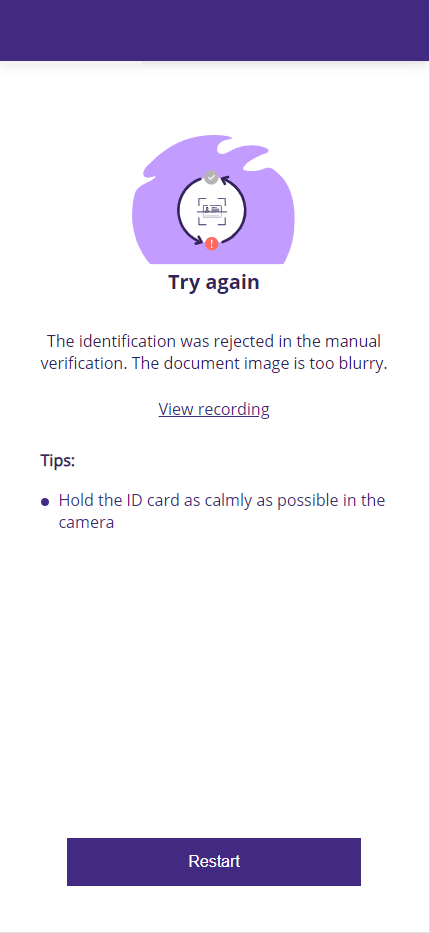
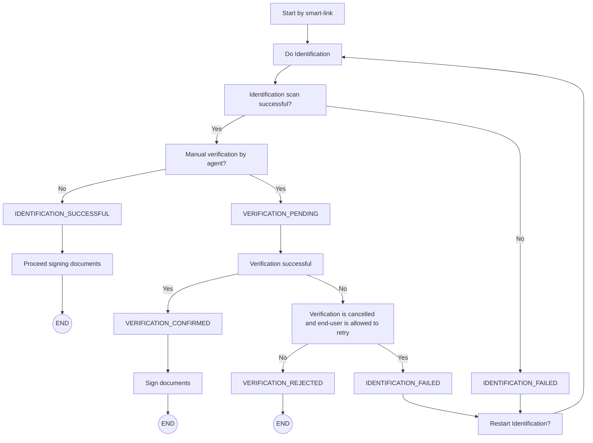

# AutoIdent (Intrum) verification canceled flow

After the identification an agent performs a manual review of the identification.

If the identification verification is canceled by the agent because the quality of the scanned result is not sufficient, the case will be updated to IDENTIFICATION\_FAILED. In this case the enduser is shown the identification failed page. The enduser can click on a restart button on this page, to start over. In his case the status is updated to INITIALIZED again.

<figure><figcaption></figcaption></figure>

If the identification is rejected by the agent due to fraud reasons, the case status will be updated to VERIFICATION\_REJECTED. In this scenario the enduser will not be able to start the identification case again.

Example verification is canceled flow when the end-user using smart-link to start identification and signing process

