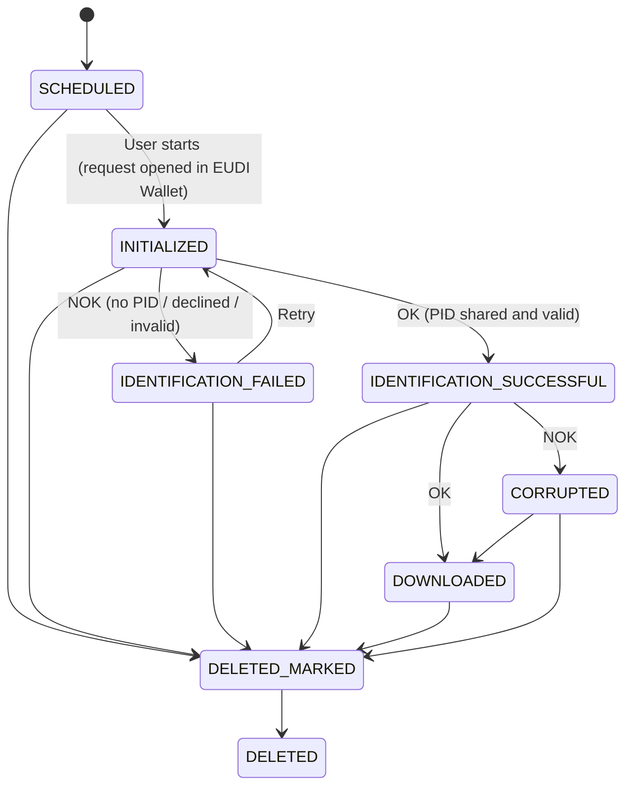

# EUDI Wallet status logic

On every status update a notification is sent to the external application. With the provided APIs a case can be scheduled and the details of an identification case and the files can be downloaded.

<table data-full-width="true"><thead><tr><th width="317">Status</th><th>Description</th></tr></thead><tbody><tr><td>SCHEDULED</td><td><ul><li>The identification case is scheduled. The available personal data is posted to the identification application.</li><li>A startlink is created and a unique identification case id created.</li></ul></td></tr><tr><td>INITIALIZED</td><td><ul><li>The user has started the identification and the presentation request was opened in the EUDI Wallet.</li><li>Same-device: the EUDI Wallet is opened directly via app link. Cross-device: a QR code is shown which the user scans with the EUDI Wallet on the smartphone.</li><li>If the user clicks on the "Retry" button, the INITIALIZED notification is sent again after the request is opened again in the EUDI Wallet.</li><li>
Optionally, the external application can jump in, in the event of multiple retries. Depending on the integration type:
<ul><li>Jump to the identification process by using a QR code or open in a new browser: display a different page on the desktop application.</li><li>Overlay: closing the overlay</li></ul></li></ul></td></tr><tr><td>IDENTIFICATION_SUCCESSFUL</td><td><ul><li>The user approved the request in the EUDI Wallet and shared the requested PID attributes.</li><li>The presentation was validated successfully (signature, issuer trust, validity and revocation status of the credential, holder binding).</li><li>No manual verification by an agent is required, the status is final for the identification and the case can proceed to signing.</li></ul></td></tr><tr><td>IDENTIFICATION_FAILED</td><td>
The status is set to IDENTIFICATION_FAILED after INITIALIZED if:
<ul><li>no EUDI PID is available in the user's EUDI Wallet</li><li>the user declines access to the presentation request in the EUDI Wallet</li><li>the presentation could not be validated (e.g. credential expired or revoked, issuer not trusted)</li><li>the request was not answered within the configured timeout</li></ul>
The user is taken to an error page and can start the identification again. This notification is sent for each failed identification.

The status could also be updated to IDENTIFICATION_FAILED after DOWNLOADED or IDENTIFICATION_NOT_REQUIRED because the user wants to reset the password or reset the Mobile ID for Swisscom QES signing. The end user is allowed to do identification again.
</td></tr><tr><td>DOWNLOADED / CORRUPTED</td><td>
GetCase details and download identification zip file
<ul><li>By an API the case details can be get and a zip file with all identification files including an identification report downloaded</li><li>For the file download a notification is sent if the provided zip file could be generated successfully (status DOWNLOADED) or the zip file could not be generated completely (status CORRUPTED)</li><li>When the external application receives the status CORRUPTED the download must be triggered again. When the zip could be generated completely the status will be set to DOWNLOADED</li></ul></td></tr><tr><td>DELETED_MARKED</td><td><ul><li>A case will be set to status DELETED_MARKED once the configured days for deletion have passed.</li></ul></td></tr><tr><td>DELETED</td><td><ul><li>A case will be set to status DELETED after the final deletion of a case, which is triggered 30 days after marking it as DELETED_MARKED.</li></ul></td></tr></tbody></table>


The statuses VERIFICATION\_PENDING, VERIFICATION\_CONFIRMED and VERIFICATION\_REJECTED known from AutoIdent are not used for EUDI Wallet identification.

