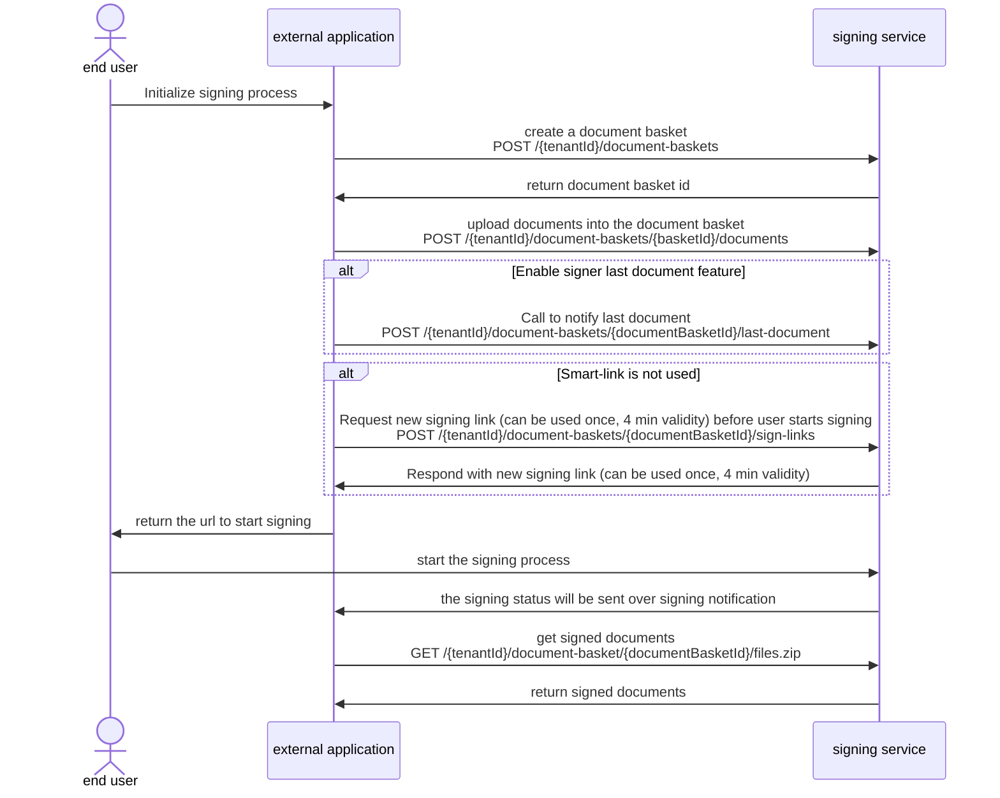

# Flow of integrated signing solution

The signing can be integrated easily into external applications. The signing process can be scheduled directly within the existing user flow of the external application by calling a REST API. Once a document basket is created, the end user can start signing. The external application will be notified by webhook on the current status of the document basket. Once the signing is completed the external application can download all signed documents per REST API.

