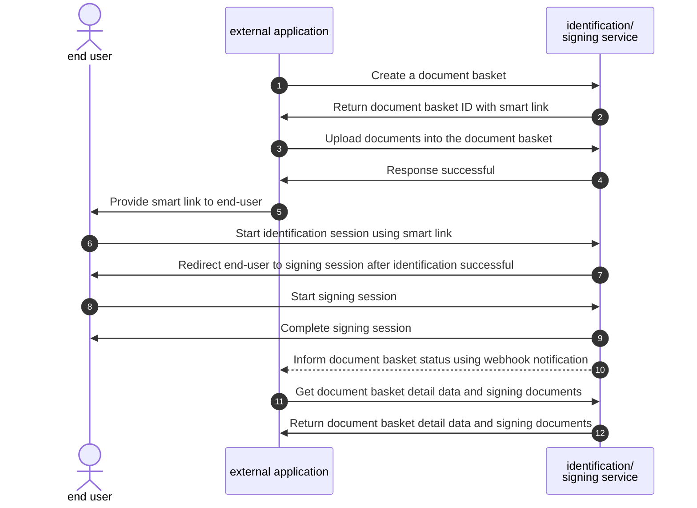

# Signing Integration

Example use case:

* Create a document basket
* Upload documents into the document basket
* Signers start signing the documents
* Get original and signed documents

The authentication for the signing API requires the consumer to send the proper token. seal.ID provides an easy way to configure and get the token that the request requires.

## Signing profile

Upon the registration of the tenant, a default configuration of the signing process will be initialized.

It is also possible for a tenant to add additional configurations to meet with various use cases. Such additional configurations are called `signProfiles`. They can only be added by the provider and the tenant will be given the `id` so that they can be specified when creating a document basket.

## Create document basket

`POST /{tenantId}/document-baskets`

This API used to create a document basket. The document basket will contain documents which will be signed by one or multiple signers. `ubiSignProfileId`, `ubiIdConfiguration`, `signers` must be defined in the request body.

* ubiSignProfileId: configuration of the signing process
* ubiIdConfiguration: configuration of the identification process. This configuration will define the need of identity process for signers using `doIdentification`, identity configuration profile using `ubiIdProfileId`.
* signers: list of persons requested to sign the documents belonged to the document basket.

The response will return a `documentBasketId` and list of created signers, each signer will have `ubiIdUrl` to do identification (if needed) and `ubiSignUrl` to start signing process.

NOTE: The `ubiSignUrl` created in this API will be attached with `nonce` and it can be used once to start the signing process during the lifetime of 4 Minutes of the 'nonce'.

## Upload documents into document basket

The documents to be signed have to be uploaded as PDF files with the following API endpoint:

POST `/{tenantId}/document-baskets/{documentBasketId}/documents`

It is recommended to flatten the PDF files before uploading, since some dynamic fields (e.g. form fields) can interfere with the signature validation of commonly used PDF readers.

## Signing Start Links Validity

In order that the external application can control in what time span and context a user is able to sign, each start link generated can only be used **once** and has a very **short** lifetime.

To achieve this, each start link will contain a parameter `&nonce=ABCDEF12345`. The `nonce` is an one-time token and has a short lifetime (default to 4 minutes). The signing application will use this `nonce` to acquire an access token which has to be used on every subsequent calls to the internal signing APIs. Without a valid `nonce`, the start link will be completely useless.

When a new `DocumentBasket` is created via the operation `postDocumentBasket`, the start links for signing process includes a new `nonce` for each Signers. However, if the link expires, Tenants can use the operation `requestNewSignLinks` to obtain the new start links with new valid `nonce`. Tenants are free to add more parameters into the provided URLs but **MUST** ensure that the `nonce` is always present.

#### Additional URL Parameters

* _`language`_: Specify the preferred language to display. Supported values are `de` (default), `en`, `it`, `fr`.

## Sign the documents

By opening the `ubiSignUrl` directly in the browser or in an iFrame the end user can go through the signing process and sign the documents.

#### Smart link

The smart link allows end-users able to do identification and signing documents in one session. For example:

If the end-user terminates by accident in the middle of any process, using this link will navigate end-user to the appropriate step where end-user has left off.

The smart link feature can be enabled by the provider. The `ubiIdUrl` value in the create document basket response will become an smart link when the feature is enabled.
