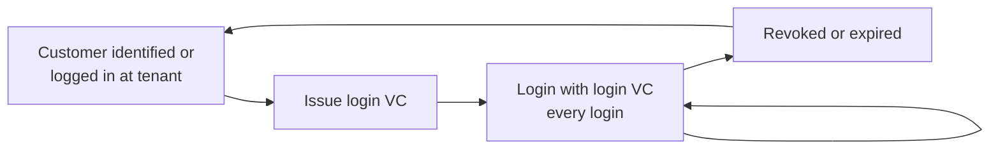

# Login VC

The **login VC** is the credential the end user presents to log in with the EUDI Wallet. The DTP issues it once per customer and wallet (enrolment) on behalf of the tenant. On every login the end user presents it through the [EUDI Wallet authentication flow](../../authentication-services/eudi-wallet/eudi-wallet-authentication-flow.md).

## What the login VC contains

<table data-full-width="true"><thead><tr><th width="220">Property</th><th>Description</th></tr></thead><tbody><tr><td><strong>Format</strong></td><td>SD-JWT VC (<code>dc+sd-jwt</code>).</td></tr><tr><td><strong>Issuer</strong></td><td>The DTP on behalf of the tenant. Name and logo of the tenant are shown in the wallet (display metadata of the VC profile).</td></tr><tr><td><strong>Claims</strong></td><td><code>customerId</code> (mandatory). Additional claims only if defined in the VC profile. No personal data by default.</td></tr><tr><td><strong>Holder binding</strong></td><td>Bound to a key of the end user's wallet. Only this wallet can present the login VC.</td></tr><tr><td><strong>Validity</strong></td><td>Defined in the VC profile, can be shortened per request with <code>validUntil</code>.</td></tr><tr><td><strong>Revocation</strong></td><td>Revocable by the tenant at any time via status list. See <a href="revoke-login-vc.md">Revoke login VC</a>.</td></tr></tbody></table>

## Lifecycle

1. **Known customer.** The customer is already identified or logged in at the integrating customer. The integrating customer is responsible for this, see [Responsibility of the integrating customer](login-vc-issuance-flow.md).
2. **Issue the login VC.** See [Login VC issuance flow](login-vc-issuance-flow.md).
3. **Log in.** On every login the end user presents the login VC. See [EUDI Wallet authentication flow](../../authentication-services/eudi-wallet/eudi-wallet-authentication-flow.md).
4. **Revoke or expire.** When the login VC is revoked or expired, a new login VC must be issued.

## Login VC documents


[supported-wallets.md](../../authentication-services/eudi-wallet/supported-wallets.md)



[login-vc-issuance-flow.md](login-vc-issuance-flow.md)



[login-vc-api.md](login-vc-api.md)



[revoke-login-vc.md](revoke-login-vc.md)



[login-vc-status-and-errors.md](login-vc-status-and-errors.md)

