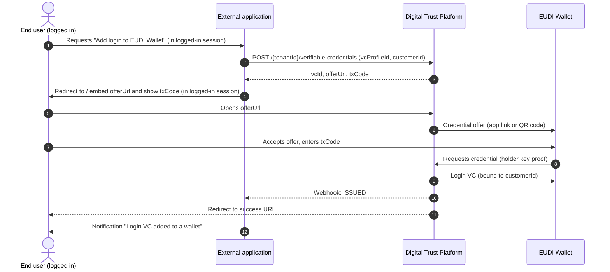

# Login VC issuance flow

The login VC is issued once per customer and wallet (enrolment). Afterwards the end user logs in with it, see [EUDI Wallet authentication flow](../../authentication-services/eudi-wallet/eudi-wallet-authentication-flow.md).

## Responsibility of the integrating customer

The login VC is only issued for a customer who is **already identified or logged in** at the integrating customer. The DTP does not verify the identity of the end user at issuance: whoever accepts the offer receives a login VC for the given `customerId` and can log in with it.

The integrating customer is therefore responsible to:

* **Submit the `customerId` of a known customer only.** Create the login VC only for a customer who was identified before (e.g. via an identification case) or who is logged in with an existing login method.
* **Deliver the offer only to this customer.** Show the `offerUrl` (or the QR code) and the `txCode` only inside the authenticated session of this customer, e.g. in the logged-in web or mobile app. Never send the offer link by e-mail or in an unauthenticated message.


If the offer link and the `txCode` reach another person, this person can obtain a valid login VC for the customer. Revoke the login VC immediately in this case, see [Revoke login VC](revoke-login-vc.md).


## Sequence



## Steps

1. **Create the login VC.** In the authenticated session of the customer, the external application calls the create endpoint with the `vcProfileId` and the `customerId` of this customer. See [Login VC API](login-vc-api.md).
2. **Embed the offer link.** Redirect the end user to the `offerUrl` (recommended) or embed it in an iFrame, within the logged-in session, and show the `txCode`.
   * **Same-device:** on a smartphone the wallet opens directly via app link.
   * **Cross-device:** on a desktop a QR code is displayed which the end user scans with the wallet.
3. **Accept the offer.** The end user accepts the offer and enters the `txCode` in the wallet, if required.
4. **Get the result.** The end user is redirected back and the status is sent via webhook (see below).

## Redirect after issuance

After the issuance the end user is redirected to the success or failed redirect URL. The `vcId` and the `state` are attached as query parameters.

```http
HTTP/1.1 302 Found
Location: https://app.example.com/wallet/done?vcId=b1e3a9f2-0c4d-4f61-8a2e-9d7c5e3f1a08&state=q2Zt8kLmV0
```

The redirect target is either the static success / failed redirect URL of the profile or the `redirectUri` submitted in the request. The `redirectUri` must match an allowed redirect URI of the profile.


Do not rely on the redirect alone. Confirm the status via webhook or `GET /{tenantId}/verifiable-credentials/{vcId}` before marking the customer as "login VC active".


Status updates are sent to the webhook URL of the tenant, signed as described in [Webhook notifications](../../general-information/webhook-notifications.md). See [Login VC status and errors](login-vc-status-and-errors.md) for all status values.

## Security considerations

* **Issue only to a known customer.** Create the login VC only within an authenticated session of an identified customer.
* **Deliver the offer in the session only.** Never send the `offerUrl` by e-mail or in an unauthenticated message.
* **Protect the transaction code.** The `txCode` prevents another person from claiming the offer, e.g. from a forwarded link or a photographed QR code. Show it only in the logged-in session and never put it in the URL.
* **Keep offers short-lived.** Offers are single-use and valid for 30 minutes by default. Do not extend this without reason.
* **Notify the customer.** Inform the customer through an existing channel (e.g. e-mail) when a login VC was issued, so that an unwanted issuance is noticed and can be revoked.
* **One active login VC per wallet.** When a customer requests a new login VC, [revoke](revoke-login-vc.md) the previous one.
