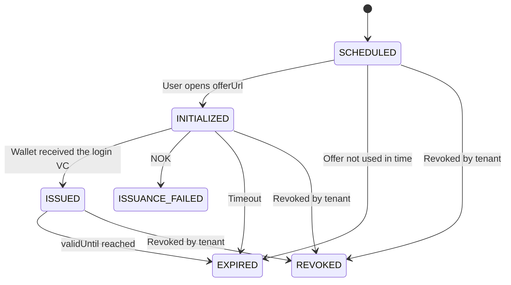

# Login VC status and errors

Status of the login VC (issuance and lifecycle). For errors during the login see [EUDI Wallet authentication status and errors](../../authentication-services/eudi-wallet/eudi-wallet-authentication-status-and-errors.md).

## Status logic

<table data-full-width="true"><thead><tr><th width="260">Status</th><th>Description</th></tr></thead><tbody><tr><td>SCHEDULED</td><td>The offer was created and the <code>offerUrl</code> returned.</td></tr><tr><td>INITIALIZED</td><td>The end user opened the <code>offerUrl</code> and the offer was opened in the wallet.</td></tr><tr><td>ISSUED</td><td>The login VC was issued to the wallet. The end user can log in with it.</td></tr><tr><td>ISSUANCE_FAILED</td><td>The issuance failed, see <code>statusReason</code> and <code>statusDetails</code>. A new offer must be created for a new attempt. Final status.</td></tr><tr><td>EXPIRED</td><td>The offer was not accepted in time, or the issued login VC reached <code>validUntil</code>. Final status.</td></tr><tr><td>REVOKED</td><td>The offer was withdrawn or the login VC was revoked by the tenant. See <a href="revoke-login-vc.md">Revoke login VC</a>. Final status.</td></tr></tbody></table>

Status updates are sent to the webhook URL of the tenant, signed as described in [Webhook notifications](../../general-information/webhook-notifications.md).

## Issuance error codes

On failure the values below are returned as `statusReason` and `statusDetails` in the [Login VC API](login-vc-api.md) and the webhook.

<table data-full-width="true"><thead><tr><th width="140">statusReason</th><th width="280">statusDetails</th><th>Description</th></tr></thead><tbody><tr><td><code>ABORTED</code></td><td><code>USER_DECLINED_OFFER</code></td><td>User declined the offer in the wallet.</td></tr><tr><td><code>ABORTED</code></td><td><code>USER_CANCELLATION</code></td><td>User aborted on the DTP page.</td></tr><tr><td><code>CANCELED</code></td><td><code>INVALID_TX_CODE</code></td><td>Wrong transaction code entered too many times.</td></tr><tr><td><code>CANCELED</code></td><td><code>WALLET_NOT_SUPPORTED</code></td><td>The wallet does not support the credential format or third-party attestations. See <a href="../../authentication-services/eudi-wallet/supported-wallets.md">Supported wallets</a>.</td></tr><tr><td><code>ABORTED</code></td><td><code>STALLED_TIMEOUT</code></td><td>The wallet did not answer within the configured time.</td></tr><tr><td><code>ABORTED</code></td><td><code>WALLET_TECHNICAL_ERROR</code></td><td>Technical error in the wallet or the DTP.</td></tr></tbody></table>

For revoked login VCs `statusReason` is `REVOKED_BY_TENANT` and `statusDetails` contains the revocation `reason`.
